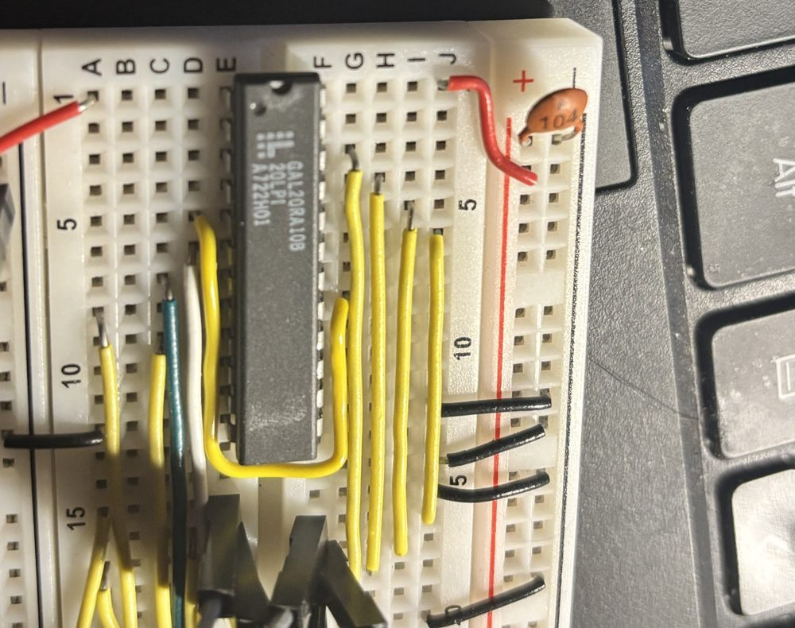

# Michael's SPI interface in logic chips: 2022 to 2025

Michael drives its ILI9341 display, an SPI device, from a VIA: a byte on port B and a strobe, E. Between the
two sat an interface that turns each strobe into eight SPI clocks. From 2022 to 2025 it was designed in logic
chips, four times over: in Logisim and Digital in September 2022 (the board Michael used until 2026), and as a
two-way interface in 74LS chips and then in a GAL20RA10 in October 2025, meant for a W5500 Ethernet module. The FPGA designs that ran alongside
from 2024 are in [`michael-fpga-display-earlier-designs.md`](michael-fpga-display-earlier-designs.md), and the
Cmod A7 replaced the board on 2026-10-03 ([`spi-display`](../hardware/michael/fpga/spi-display/)).

The files are now in [`hardware/michael/spi-interface/`](../hardware/michael/spi-interface/), byte for byte as
found on 2026-10-25, with SVG pictures of the Digital circuits. They came from:

- Windows `Documents/From work computer via tesla drive/Phil/Misc/Personal/`: the 2022 Logisim and Digital files,
  the CUPL export and `test.v` (the 2024 copies in the Ubuntu install's `Documents/digitaldisplaydriver/` are
  identical);
- Windows `Documents/PS2 Keyboard and mouse interface/SPI Interface/`: the 2025 KiCad project;
- `~/research/pld/` (WSL, its own git repository): the GAL design; `~/research/GALasm/examples/test/`: the GAL
  bring-up files.

**Not found:** notes of logic equations worked by hand to minimise the interface. Text, Markdown, Office and
OneNote files were searched in WSL's home directory, the copy of the external drive and Windows `Documents`,
`Desktop`, `Downloads` and OneDrive, for the designs' signal names (BRST, srS1, MISOr, 74HC299 and others).
What survives of the minimising is in the designs themselves: Digital's CUPL export (2022) and the
GAL equations' history (2025).

## Timeline

| Date | What | Files |
|---|---|---|
| 2022-09-13 | The interface in Logisim: one flat circuit of D flip-flops and gates | `logisim/SPI.circ` |
| 2022-09-15 | Logisim again, with sub-circuits for the 4017 counter and the shift register | `logisim/SPI2.circ`, `SPI3.circ` |
| 2022-09-15 | A 74299 for reading MISO back, tried in Logisim and in Digital | `logisim/299.circ`, `digital/shtest.dig` |
| 2022-09-15 | The circuit in Digital, with a 4017 of its own and the 74299 read path | `digital/D-SPI.dig`, `e-4017.dig` |
| 2022-09-16 08:20 | Active-low E, Digital's 74HC4017, and a test, which passes | `digital/D-SPI2.dig` |
| 2022-09-16 08:42 | One of D-SPI2's functions exported to CUPL for a GAL16V8 | `digital/CUPL_D-SPI2/CUPL.PLD` |
| 2022-09-16 09:32 | A state machine from Digital: E starts a burst of SCLK, then waits for E to fall | `digital/test.v` |
| 2022-09-16 | `hello_michael_spi.s` committed (13:31), then `graphics_display.inc` (19:46): the board is in use | [`firmware/programs/michael/hello_michael_spi.s`](../firmware/programs/michael/hello_michael_spi.s) |
| 2024-10-15 | The write-only circuit, exported to Verilog for the first FPGA try | `digital/D-SPI-WriteOnly.dig`, `.v` |
| 2025-10-03/04 | "Bidirectional SPI interface" rev 0.1 in 74LS chips, drawn in KiCad overnight | `kicad/SPI Interface.kicad_sch` |
| 2025-10-04 | GAL20RA10 bring-up: GALasm and the TL866II+ programmer, register by register | `gal/bring-up/` |
| 2025-10-04 to 10 | The same interface in a GAL20RA10 and a 74HC299, programmed and tried on a breadboard | `gal/spi-control.pld` |
| 2025-10-11 | minipro: "Fix bit order for gal20ra10 negation flags" (`~/research/minipro`, `366c50f`): every output's polarity had gone to its mirror-image output | — |
| 2026-10-03 | The Cmod A7 replaces the 2022 board | [`fpga/spi-display/`](../hardware/michael/fpga/spi-display/) |
| 2026-10-25 | The GAL board and a W5500 on Michael, the FPGA board unplugged: VERSIONR reads right, 4096 times in 4096, after three wiring faults | [`michael_w5500_version.s`](../firmware/programs/michael/michael_w5500_version.s) |

## 2022: the board Michael used

The circuit is a 74HC165 shift register and a 4017 decade counter, clocked by Michael's CPU clock. While the
counter is at 0 the '165 follows port B. E starts the count, SCLK is the CPU clock for counts 1 to 8, and the
counter waits at 9 until E falls. [`michael-fpga-display-earlier-designs.md`](michael-fpga-display-earlier-designs.md#the-74-series-circuits)
describes it, and what went wrong when it was put in an FPGA.

The dates now tie it to the board: the Digital files are from 15 and 16 September 2022, and Michael's first
SPI program was committed at 13:31 on the 16th. The board was the write-only part: the driver has only ever
written, with E active high, as in `D-SPI.dig` and `D-SPI-WriteOnly.dig` (`D-SPI2.dig` has E active low). So
the 74299 read path (`D-SPI.dig`, `D-SPI2.dig`) went unused, if it was built at all.

Two files from the morning of the 16th look like the first attempts to shrink the logic:

- **`CUPL_D-SPI2/CUPL.PLD`**: Digital's export of one combinational function, Y of five inputs (A, B, C, E, F),
  as a sum of six products for a GAL16V8. Digital's analysis renamed the signals, so which part of D-SPI2 it
  is isn't recorded.
- **`test.v`**: Digital's Verilog of a state machine it synthesised (its `Z_n` state names): three flip-flops,
  inputs E and the clock, output SPICK. E starts two SCLK pulses at half the clock rate, and the machine then
  waits until E falls (checked by simulation). It's the shape of the 2025 designs, with a burst of two.

`logisim/299.circ` names a Logisim 74x299 library (`Logisim/74x299.circ`, one of several downloaded 7400
libraries) that isn't committed here. The '299 it uses is its own sub-circuit.

## 2025: two-way, in 74LS chips

A KiCad schematic, rev 0.1, dated 2025-10-04: a 74LS74, 74LS08 ×2, 74LS32, 74LS04, a 74LS163 counter and a
74LS299, with connectors for the data (d0–d7), the controls (CLK, E, /RST) and SPI (SCLK, MOSI, MISO). The
sheet describes it:

> Supports SPI mode 0 as a master.
> - While E is low, data is loaded on every rising edge of CLK
> - When E goes high, data is clocked out of MOSI and into MISO
> - If E remains high after 8 clocks, received data is output until E goes low
> - If E goes low before 8 clocks then received data is not output

There's no `~read` connector: the read strobe is internal, and it turns the '299's outputs onto the data lines.
The PCB file has the footprints placed but no tracks: the board was never routed.

The logic, from the schematic's netlist (KiCad wasn't available, so the netlist was extracted from the file;
every junction of wires has its dot, so it isn't ambiguous):

| Signal | Logic |
|---|---|
| BRST (74LS74 2Q) | D = (BRST + E) · /TC, clocked by CLK; cleared by /RST |
| SCLK | /CLK · BRST |
| MISOr (74LS74 1Q) | MISO, clocked by SCLK; cleared by /RST |
| Counter ('163) | loads 8 when (E · /BRST · /TC) + (/E · TC); counts when CEP = **/BRST** · /TC; TC at 15 |
| read (the '299's S0 and output enables, active low) | /BRST · TC |
| '299 S1 | /BRST · /read |
| '299 | MOSI from Q7; MISOr into DS0 (and DS7); clocked by CLK |

**It doesn't work as drawn.** The counter's count enable is gated by /BRST, the flip-flop's inverted output,
so the counter stands still at 8 during a burst, TC never comes, and SCLK never stops. Fed from BRST instead
(one wire, U5 pin 1 from U1 pin 9 instead of pin 8), a gate-level simulation of the netlist behaves as the
sheet says: E loads 8 and starts the burst, the count runs 8 to 15 (eight SCLK pulses), and at 15 the burst
ends. If E is still high, the '299 holds the received byte with its outputs on, until E falls. When E falls
the counter reloads 8. All the backups from the night (01:27 to 08:00 on 4 October) have the same wiring.

## 2025: the same in a GAL20RA10

The next day the glue logic went into a GAL20RA10, leaving the 74HC299. The 20RA10 suits it: every output has
its own register with a product-term clock, and an asynchronous reset and preset.

**Bring-up first (4 October).** `gal/bring-up/` holds the day's test designs, assembled with GALasm
(`~/research/GALasm`, daveho/GALasm with the fixes made for this work in 2022–2023) and programmed with
minipro on a TL866II+ (its GAL20RA10B support was added to minipro for this work in 2022, `c2718bf`).
`my_20ra10.pld` (combinational, "tested OK"),
`my_20ra10_sequential*.pld` and `try_01` to `try_07` (registered outputs, an inverted clock, then asynchronous
reset and preset, never both at once) built up to the registered features the interface needs. The readbacks
compared along the way (`before-2`, `after-3` and so on) stayed in `~/research/GALasm/examples/test/`.
A week later, minipro got "Fix bit order for gal20ra10 negation flags" (2025-10-11).

**The design, `gal/spi-control.pld`.** Its history is in `~/research/pld`:

| Commit | When | Change |
|---|---|---|
| `707836c` | 10-04 23:59 | First version: a 3-bit counter (C0–C2), burst (nBRST) and wait (nWAIT) registers, SCLK, MISOr |
| `609fcce` | 10-05 00:17 | `program-spi.sh`: `minipro -p GAL20RA10B -P -w spi-control.jed` |
| `0adca39` | 10-05 00:23 | srS1, the '299's S1; comments |
| `c9d192c` | 10-05 00:51 | /RST, a synchronous reset in every register |
| `af84dfd`, `0c8efef`, `38ee59d` | 10-05 00:57–01:05 | The active-low signals as GALasm's `/X` instead of `nX` |
| `c97edf2` | 10-05 01:30 | "Shift register S0 and output enable – fix for them going low too soon": a separate srS0OE output. (`Documents/spi-control.pld` on Windows is this version.) |
| `3ddabaa`, `c1cf844` | 10-06 23:03 | "Simplify logic": WAIT becomes OUTPUT, which drives S0 and the output enable itself; the counter and BRST outputs active low |
| uncommitted | 10-10 | /dBRST, BRST delayed outside the GAL, gates SCLK. The `spi-control.jed` committed there is built from this version (reassembled on 2026-10-25: identical). |

How it works: BRST is set on a rising CLK (Phi2) when E is high, OUTPUT is clear and the count is 0, and holds
while the count runs 0 to 7. SCLK is /CLK · dBRST, so its eight pulses are the CPU clock's low halves. MISOr
samples MISO on SCLK's rising edge, and the '299 shifts it in on the next rising CLK, while Q7 shifts out on
MOSI. At the count of 7, if E is still high, OUTPUT is set: the '299 holds (S0 = S1 = 0) and drives the byte
onto the data lines until E falls. The '299 loads from the data lines on every clock while idle. A simulation
of the equations with a '299 and a mode 0 device sends 0x3C and holds 0xA5 for reading. With a short E the byte
still goes out and nothing is held.

Notes on it, from the review of 2026-10-25:

- **The 74LS design's counter fault isn't here.** The GAL design counts only during the burst from its first
  version.
- **E is sampled on Phi2.** Unlike the 2022 board and the first FPGA design, a spike on E can't start a
  byte between clock edges.
- **dBRST is BRST's trip out of the chip and back in.** On the breadboard pin 17 (/BRST) is wired straight to
  pin 5 (/dBRST) (the photo below). Without the loop, SCLK would be /CLK · BRST, and BRST changes on CLK's rising
  edge, the same edge that ends /CLK. Inside the chip, the edge reaches SCLK's AND term two ways: through pin 6's input buffer as
  /CLK, and through the same input, the product-term clock and BRST's register as BRST. The register makes the
  second way the longer, but only by a delay the data sheet doesn't guarantee. If BRST arrived first, the AND
  term would see /CLK and BRST both high for a moment, and SCLK would show a runt pulse as a burst begins. Taken
  out through pin 17's output buffer, along the wire and in through pin 5's input buffer, BRST arrives a whole
  pass through the chip later (some 20 ns on a -20 part), when /CLK has long gone low. At the end of a burst
  dBRST falls just as late, while /CLK is still low, so no pulse is cut or added. It works as long as the trip
  is shorter than Phi2's high half (250 ns at 2 MHz).
- **A second strobe during a burst is lost.** If E rises again before the burst ends, it's taken as "hold the
  byte". Strobes must be at least nine clocks apart, as on the 2022 board.
- **Port B when reading.** The '299 drives the data lines from the end of the burst while E is high. Michael
  must turn port B to input before then.
- **Tie pin 1 (/PL) high and pin 13 (/OE) low**, and take /RST from the 6502's reset.
- **No chip select.** It's left to a separate VIA pin.
- **Stale comments.** The description says 74HC922 (the S0/S1 table is the 74HC299's) and names
  `WAITsrS0OE`, now /OUTPUT.

### On the breadboard

The GAL was programmed and tried on a breadboard in October 2025, for a W5500 Ethernet module. Its wiring in
the photo matches `spi-control.pin`: /PL (pin 1) to +5 V, the pin 17 to pin 5 loop, CLK, E, MISO and /RST on
pins 6 to 9, srS1, /OUTPUT, MISOr and SCLK out on pins 22 to 19, /OE (pin 13) to ground. It didn't transfer
data correctly: something seemed to trigger falsely. The details weren't written down.

**Not minipro's bug.** The JEDEC file is from the evening of 10 October, and minipro's fix for the GAL20RA10's
polarity fuses came at noon the next day: before it, minipro wrote fuses 3200–3209 in reverse, each output
getting the polarity meant for its mirror image (pins 14 and 23, 15 and 22, and so on). GALasm puts pin 23's
polarity in fuse 3200 and pin 14's in 3209. Programmed that way, SCLK would have run with Phi2 while idle, and
MISOr and srS1 would have been inverted. But the chip read back on 2026-10-25 (with `~/projects/minipro`, which
has the fixed order) matches `spi-control.jed` fuse for fuse, `0101100000` included: it was programmed, or
reprogrammed, correctly. The bring-up design that "tested OK", `my_20ra10.pld`, had all ten outputs active high,
so the bug couldn't show in it.

### Tried again, 2026-10-25: working

Michael's FPGA board unplugged, the GAL board on its port B and port A, and the W5500 module on the GAL's SPI.
[`michael_w5500_version.s`](../firmware/programs/michael/michael_w5500_version.s) reads the W5500's VERSIONR
(`$0039`, always `$04`) in rounds of 4096 and counts the results. Three faults, found in turn:

1. **The data connector was reversed.** The 8-wire bundle's colours are a slice of rainbow ribbon and carry no
   meaning; on the GAL board **khaki/brown is I/O0 and yellow I/O7**, so khaki/brown goes beside the LCD ribbon's
   khaki (E) conductor, on D0/PB0, and yellow beside its red (backlight A), on D7/PB7. Reversed, every byte went
   out and came back bit-reversed: the address `$0039` reached the W5500 as `$009C`. A loopback (GAL pin 8, MISO,
   jumpered to the '299's Q7) passed regardless, because its test byte, `$A5`, reads the same backwards: a
   loopback can't see a scrambled port B, only a stuck or open line.
2. **PB7 had a poor contact**: bit 7 of every read was high. Reseating fixed it. PB0 still measures about 200 Ω
   end to end, a poor contact that doesn't matter at these speeds but should be redone.
3. **A glitch on the chip select.** About one read in six returned `$02`. The scope showed why: while a frame's
   address and control bytes go in, the W5500 puts out a count on MISO, `$01`, `$02`, `$03`, and in the bad
   frames burst 3 carried `$01` and burst 4 `$02`. The W5500 had started a new frame at burst 3, so CS had gone
   high between bursts 2 and 3. That is where the program writes `$00` over `$39`, four port B lines falling at
   once, the only falling transition in the frame; the scope showed a spike on CS there. 100 pF from CS to
   ground at the module cured it: 4096 good reads a round. The spike is ground bounce or crosstalk from port B
   (more below).

None of these was the GAL design itself; whether the 2025 fault was the same isn't recorded, but the CS glitch
fits "something seemed to trigger falsely".

On the way, the 100 Ω in series with SCLK and the 100 pF on it made no difference and came off; SCLK, MOSI and
the GAL's timing were clean throughout. The supply at the GAL board measured 4.3 V (4.8 V from the USB serial
adapter), below the GAL20RA10B's 4.75 V minimum, with the W5500 drawing about 130 mA: worth a stronger supply.

The emulator now models the interface and the W5500 (`--add gal-spi,w5500`, `emulator/chips/gal_spi.h` and
`emulator/chips/w5500.h`, the W5500's `$01 $02 $03` included), and the program passes on it. Its CPU makes each
access on an instruction's first cycle, so it can't catch a read placed a few cycles too early after E
(`emulator/NOTES-timing-accuracy.md`); the program keeps a 12-cycle margin there.

### Ping, and the limits of the breadboard

[`michael_w5500_ping.s`](../firmware/programs/michael/michael_w5500_ping.s) gives the W5500 its network settings
(192.168.8.50 on a GL.iNet GL-MT3000's LAN), and the W5500 then answers ping by itself. It worked on the board the
same day, after the settings write had needed more work than the reads:

- **The 18-byte write never took.** Read back, it showed bytes 0 to 5 written, byte 6 lost, nothing after, and
  `$02` in GAR's second byte. A model of the W5500 parsing the frame with its chip select going high and low at
  every possible pair of bit positions matched only one case: a glitch at the end of byte 6, where port B goes
  from `$FF` to `$00` (the subnet mask, 255 255 255 0), eight lines falling at once. The W5500 then took bytes 7
  onward as a new frame, `$00 $02` an address, `$65` a control byte, `$02` the data. (Port A's pins, logged
  before each byte, ruled out the other suspect, the read-modify-write `tsb`/`trb` on port A writing back a
  misread chip select.)
- **What fixed it, on the board:** a ground wire from the VIA's pin 1 (VSS) straight to the GAL board's ground
  rail made the clearest difference, with one on to the W5500's GND; 100 pF from CS to ground at the module
  stays. 10 nF there made things worse: charging and discharging it through the VIA pin bounces the same ground.
- **What fixed it, in software** (`firmware/lib/spi/`): port B never drops more than two lines at a time
  (`gal_spi_port_b` steps a byte down), and after a read the VIA takes port B back at the level the '299 left;
  `w5500_begin` checks the W5500's answer to the control byte (`$03`); register reads are made twice and must
  agree, writes are read back, and both retry, counting the retries. On the board: `RETRIES 0001` over thousands
  of frames.
- **The emulator models the faults** (`--add` on `--machine michael`): `w5500-cs-bounce` (more than two port B
  lines falling at once glitch the chip select), `w5500-cs-flaky` (every 37th falling step does) and
  `w5500-cs-rc` (a capacitor on the chip select delays it). The programs failed under each before their fixes.

### Assessment

**The GAL design's logic is sound.** In loopback, rounds of 4096 transfers came back without an error (E, the
burst, the '299's load, shift and hold, MISOr, the hand-back of port B); its equations, simulated with a '299 and
an SPI device, send and receive the right bytes, short strobes and held ones included; on the scope the W5500's
answers matched the bits received; and the chip reads back exactly as designed. No race explains any fault
found: E is sampled on Phi2's rising edge; MOSI changes as SCLK falls, half a cycle before the W5500 samples it;
MISOr samples MISO tens of nanoseconds before the W5500 sees SCLK rise, with MISO stable since the falling edge
before. The `/dBRST` loop keeps BRST's edges in Phi2's high half, relying on the GAL's delays having a minimum
the data sheet doesn't state: a margin that holds in practice, not a guarantee.

Every fault was outside the chip: wiring (the reversed connector, PB7's contact) and signal integrity (the chip
select glitching as port B falls). The design's weaknesses, by design rather than bugs:

1. SCLK is combinational from the clock input, so noise on Phi2 at GAL pin 6 reaches SCLK; a registered SCLK
   would need a doubled clock.
2. Software keeps the protocol: E under 8 cycles on a write, port B an input within 8 cycles on a read, a strobe
   during a burst lost, interrupts off since nothing keeps the '299 and the keyboard board from driving port B
   together (the FPGA bus's SOEB interlock).
3. The supply at the GAL board measured 4.3 V, under the GAL20RA10B's 4.75 V minimum.
4. The chip select, SCLK and port B run on long jumpers side by side.

For bulk data (HTTP, through the W5500's 2 KB buffers) the checks would have to grow to chunks read back before
a SEND, at about half the speed, and a glitch mid-write can still turn data into a stray frame writing anywhere,
a socket's command register included; a Schmitt buffer on the chip select at the module, series resistors on port
B, or shorter wiring would be needed. So the W5500 goes on the FPGA bus instead, the direction already planned:
the Cmod drives its chip select and SCLK on short 3.3 V wires, from its own clock, behind the bus's filtered
strobe and the SOEB interlock.

## The files

[`hardware/michael/spi-interface/`](../hardware/michael/spi-interface/) lists them and how to open them.
