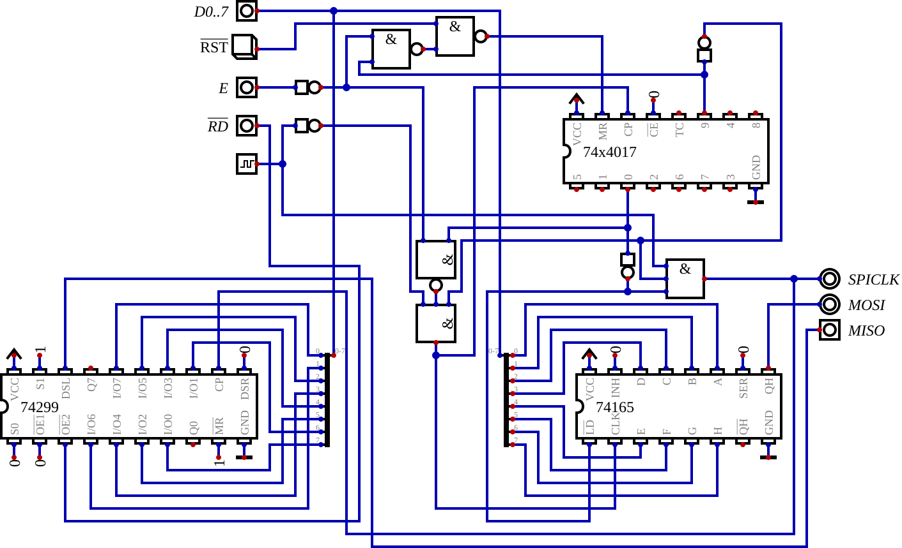

# Michael: the SPI interface in logic chips (2022–2025)

The designs for the interface between Michael's VIA and the SPI display, before the FPGA, kept as found on
2026-10-25 (file dates preserved). The write-up, with the timeline and a review of each design:
[`docs/michael-spi-interface-logic-designs.md`](../../../docs/michael-spi-interface-logic-designs.md).

| Directory | What | Open with |
|---|---|---|
| [`logisim/`](logisim/) | `SPI.circ`, `SPI2.circ`, `SPI3.circ`, `299.circ` (2022-09-13 to 15) | Logisim 2.7 |
| [`digital/`](digital/) | `D-SPI.dig` and its `e-4017.dig`, `D-SPI2.dig`, `shtest.dig` (2022-09-15/16), `D-SPI-WriteOnly.dig` and its Verilog (2024-10-15); `CUPL_D-SPI2/CUPL.PLD` and `test.v`, exported by Digital (2022-09-16); an SVG of each circuit | [Digital](https://github.com/hneemann/Digital) v0.29 |
| [`kicad/`](kicad/) | "Bidirectional SPI interface" rev 0.1 in 74LS chips (2025-10-04): schematic, and a PCB with the parts placed but not routed | KiCad 6 |
| [`gal/`](gal/) | `spi-control.pld` for a GAL20RA10 and a 74HC299 (2025-10-10) and `program-spi.sh`; [`bring-up/`](gal/bring-up/), the GAL20RA10 test designs of 2025-10-04 | GALasm, minipro |

The GAL design works on Michael with a W5500 module, which answers ping (2026-10-25, after wiring faults and
signal integrity work: see the write-up's "Tried again", "Ping" and "Assessment"; the W5500 is to move to the FPGA
bus). The emulator models the GAL design and a W5500 on it (`--add gal-spi,w5500` on `--machine michael`:
`emulator/chips/gal_spi.h`, `emulator/chips/w5500.h`), and
[`michael_w5500_version.s`](../../../firmware/programs/michael/michael_w5500_version.s) reads the W5500 through it,
on the board or the emulator.

The 74LS schematic has a wiring fault (the counter's enable from the wrong flip-flop output): see the write-up.

Digital's command line runs `D-SPI2.dig`'s test and redraws the SVGs, without a display:

```
java -Djava.awt.headless=true -cp Digital.jar CLI test -circ digital/D-SPI2.dig
java -Djava.awt.headless=true -cp Digital.jar CLI svg -dig digital/D-SPI.dig -svg digital/D-SPI.svg
```

JEDEC files are build output here (`.gitignore`). `galasm gal/spi-control.pld` makes `spi-control.jed`, identical
to the one in `~/research/pld` that `program-spi.sh` programs, with `.chp`, `.fus` and `.pin` files beside it.


